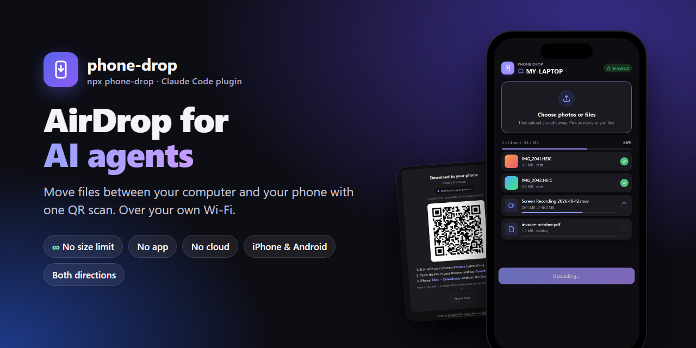
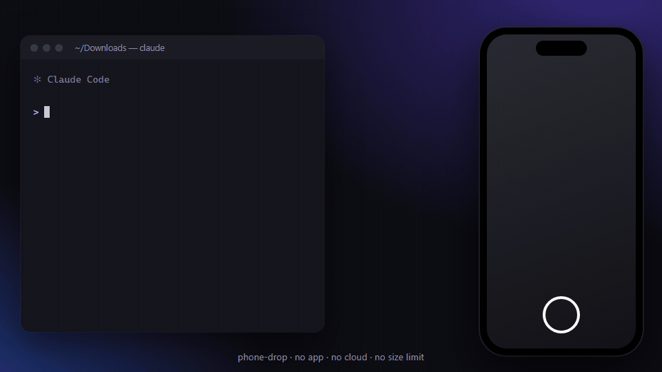
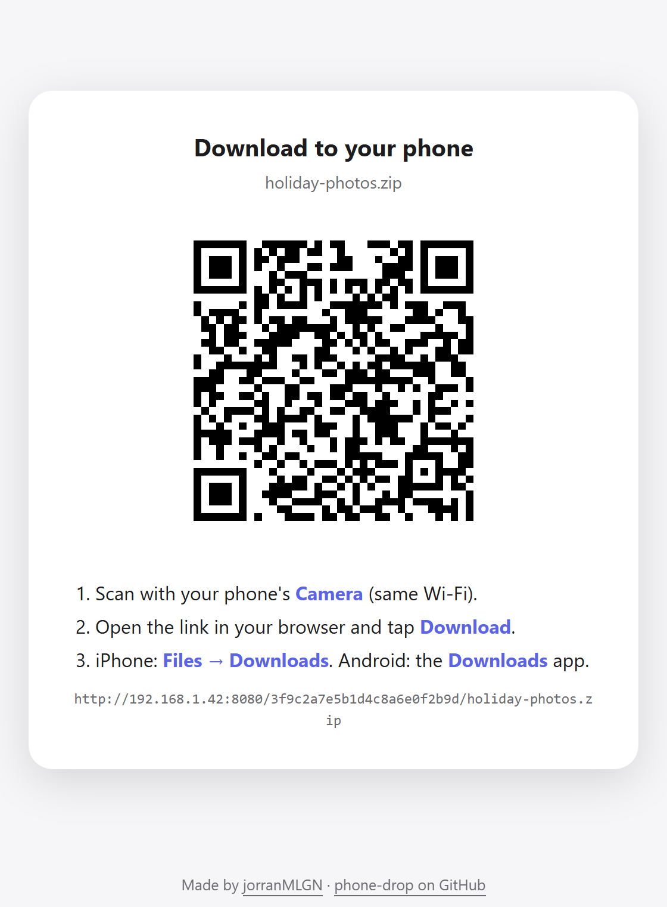
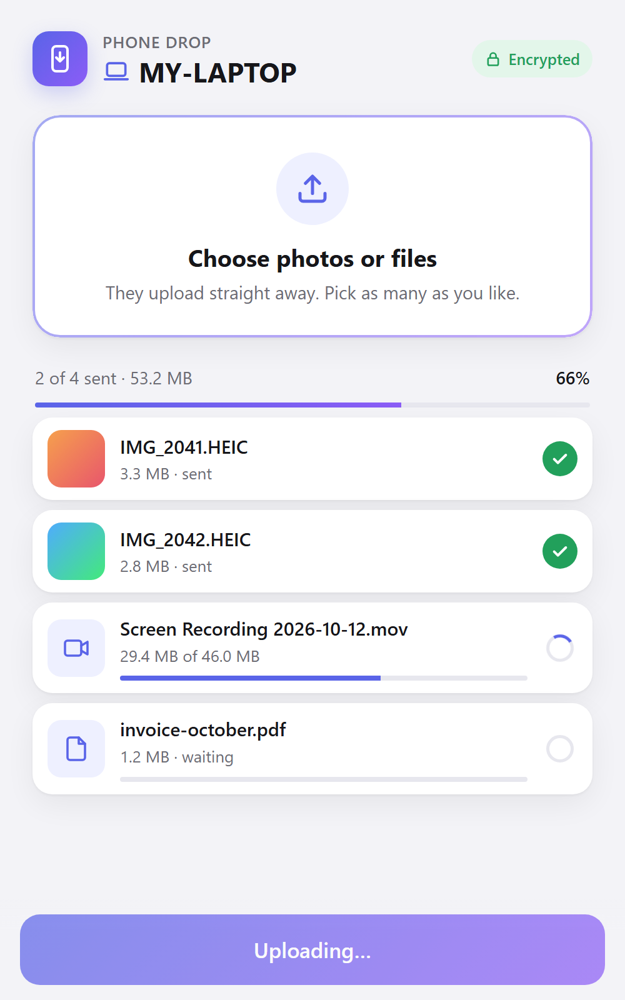
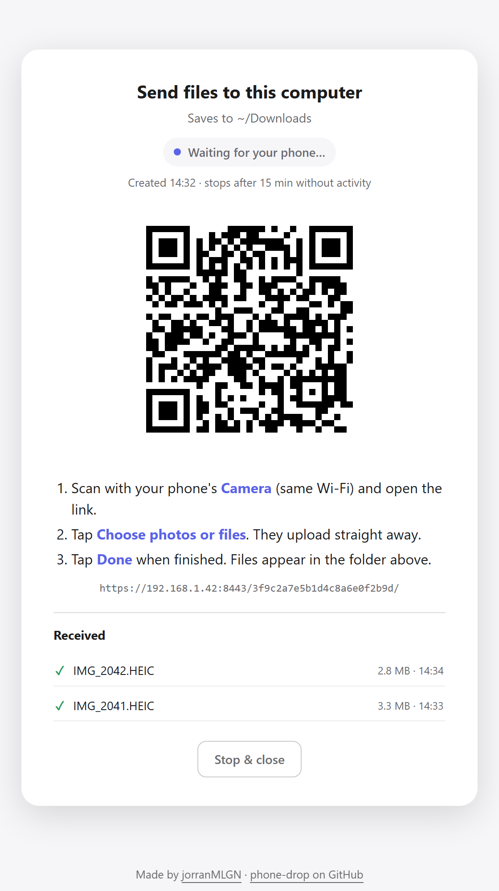
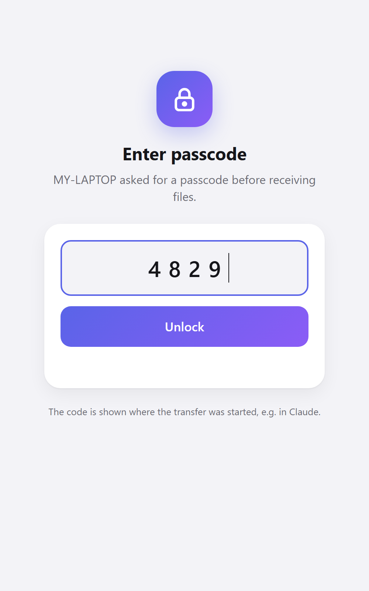
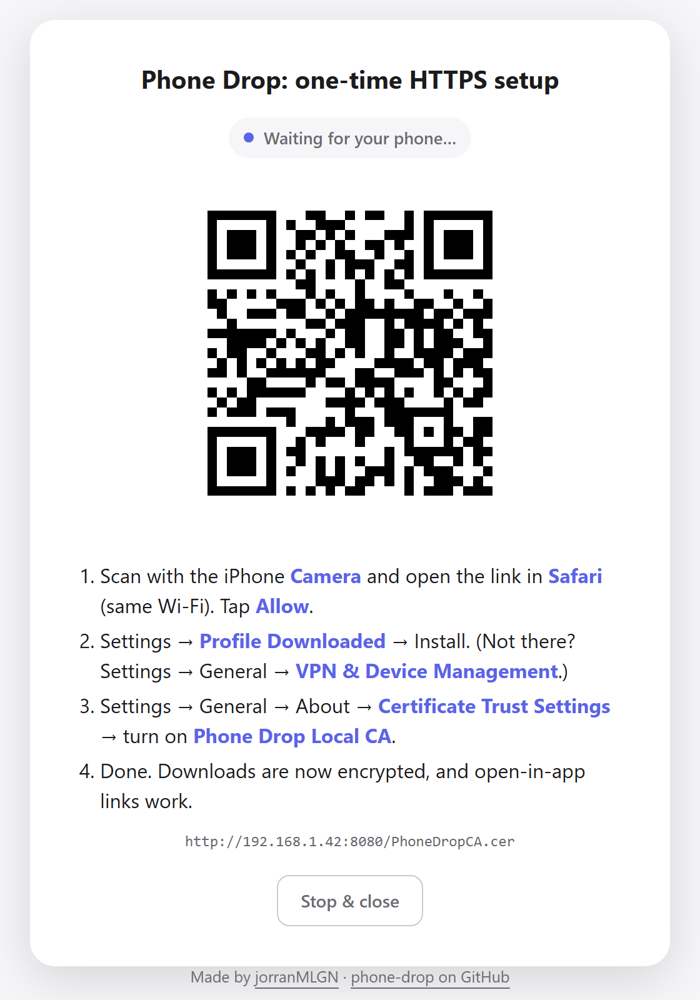
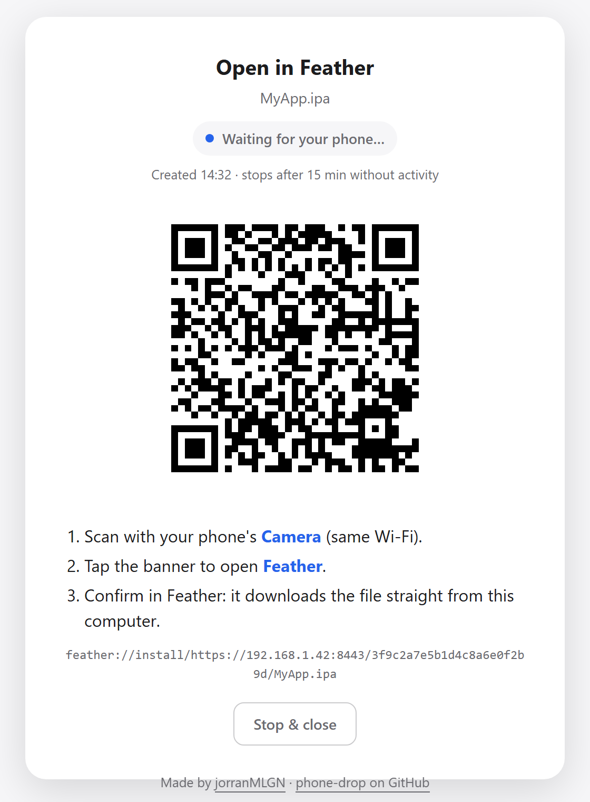

# phone-drop

<p align="center">
  
</p>

<p align="center">
  <a href="https://www.npmjs.com/package/phone-drop"></a>
  <a href="LICENSE"></a>
  
  
  
  
</p>

<p align="center"><b>Ask your AI agent (or your terminal) to put a file on your phone, or to grab files from it.</b><br>
A QR code appears, you scan it, and the files go straight between your phone and your computer over your own Wi-Fi.<br>
No app, no cable, no cloud, no account, <b>no file size limit</b>.</p>

<p align="center">
  
  <br><sub>Illustration of a send: ask, scan, done.</sub>
</p>

```text
$ npx phone-drop holiday-video.mov        # or just ask Claude Code / Codex / Gemini / Cursor

You:     "put ~/Downloads/holiday-video.mov on my phone"
Agent:   starts a one-shot server and opens a QR page in your browser
Phone:   Camera → scan → Download → done

You:     "let me upload some photos from my phone"
Phone:   Camera → scan → choose photos → they upload and land in ~/Downloads
```

<table align="center">
<tr>
<td align="center" valign="top"><b>💻 → 📱 Computer to phone</b><br><sub>Scan, tap Download</sub><br><br>
  <picture>
    <source media="(prefers-color-scheme: dark)" srcset="docs/images/download-page-dark.png">
    
  </picture>
</td>
<td align="center" valign="top"><b>📱 → 💻 Phone to computer</b><br><sub>Scan, pick photos, they upload</sub><br><br>
  <picture>
    <source media="(prefers-color-scheme: dark)" srcset="docs/images/phone-upload-dark.png">
    
  </picture>
</td>
</tr>
</table>

## Why phone-drop?

- 📦 **No file size limit.** Files stream straight from disk to disk, so a 20 GB screen recording or a full photo backup goes through like a 2 KB note. No 25 MB email cap, no "upgrade to send larger files".
- 🎞️ **Original quality.** phone-drop never compresses or re-encodes anything. Videos and photos arrive exactly as they left.
- ⚡ **As fast as your Wi-Fi.** The transfer never touches the internet: no uploading to a server first and downloading again. It even works with the internet down, as long as both devices are on the same network.
- 📱 **Nothing to install on the phone.** Just the Camera and the browser it already has. Works with iPhone and Android, from Windows, macOS and Linux.
- 🔁 **Both directions.** Send files to your phone, or upload photos, videos and documents from it.
- 🔒 **Private by design.** No cloud, no account, no third party. Each transfer uses a random one-time link that stops working when it's done. Add an optional **passcode** and HTTPS encryption for extra protection.
- 🧩 **Opens files in apps.** One scan can open the file in an app instead. [Feather](https://github.com/claration/Feather) (iOS `.ipa` sideloading) is built in, and you can add your own with a URL template.
- 💬 **Just ask your AI.** A ready-made [Claude Code](https://code.claude.com) plugin, a [snippet](#use-it-with-other-ai-agents) for Codex, Gemini CLI, Cursor, Copilot and others, or plain `npx phone-drop` in your own terminal.

### Compared to the usual ways

| | **phone-drop** | AirDrop | Cloud / WeTransfer | Email | Chat apps |
|---|:---:|:---:|:---:|:---:|:---:|
| File size limit | **None** | None | Plan limits | 25 MB (Gmail) | App limits |
| Keeps original quality | **✅** | ✅ | ✅ | ✅ | Often compressed |
| Works with Windows & Linux | **✅** | ❌ Apple only | ✅ | ✅ | ✅ |
| Works with Android | **✅** | ❌ | ✅ | ✅ | ✅ |
| Stays on your own network | **✅** | ✅ | ❌ | ❌ | ❌ |
| No account needed | **✅** | ✅ | Usually not | ❌ | ❌ |
| Phone → computer too | **✅** | Mac only | ✅ | ✅ | ✅ |
| Opens files in apps (e.g. Feather) | **✅** | ❌ | ❌ | ❌ | ❌ |

---

## Contents

1. [Install](#install)
2. [Send a file](#send-a-file)
3. [Receive files from your phone](#receive-files-from-your-phone)
4. [Optional: passcode](#optional-passcode)
5. [Optional: one-time HTTPS setup](#optional-one-time-https-setup)
6. [Open in apps (Feather and your own)](#open-in-apps-feather-and-your-own)
7. [Use it with other AI agents](#use-it-with-other-ai-agents)
8. [Configuration](#configuration)
9. [Troubleshooting](#troubleshooting)
10. [Security notes](#security-notes)
11. [Uninstall](#uninstall)
12. [Command-line reference](#command-line-reference)

---

## Install

**Requirements:**
- [Node.js](https://nodejs.org) 18 or newer
- Your computer and phone on the **same Wi-Fi network**

### From your terminal (any OS, no AI needed)

```bash
npx phone-drop photo.jpg        # send a file to your phone
npx phone-drop receive          # get files from your phone
```

Or install it once with `npm install -g phone-drop` and drop the `npx`. The QR code opens in your browser **and** is drawn right in the terminal. Run `phone-drop --help` for all options.

### As a Claude Code plugin

Inside Claude Code:

```text
/plugin install phone-drop --marketplace jorranMLGN/phone-drop
```

<details>
<summary>Older Claude Code, or installing from a terminal</summary>

```text
/plugin marketplace add jorranMLGN/phone-drop
/plugin install phone-drop@phone-drop
```

```bash
claude plugin marketplace add jorranMLGN/phone-drop
claude plugin install phone-drop@phone-drop
```
</details>

Restart Claude Code (or run `/reload-plugins`). Claude Code installs the one npm dependency (`qrcode`) automatically from `package-lock.json`. Then just ask, or use `/phone-drop:send` (💻 → 📱) and `/phone-drop:receive` (📱 → 💻).

### With other AI agents

See [Use it with other AI agents](#use-it-with-other-ai-agents): one snippet for Codex, Gemini CLI, Cursor, GitHub Copilot, Windsurf, Aider and the like.

## Send a file

Just ask in plain language:

> put `report.pdf` on my phone

> send the newest screenshot in my Downloads to my phone

Or use the slash command:

```text
/phone-drop:send ~/Downloads/report.pdf
```

Claude opens a page with a QR code in your browser (see the screenshot above). Then:

1. Scan the QR code with your phone's **Camera** app.
2. Open the link and tap **Download**.
3. Find the file on your phone:
   - **iPhone:** Files → Downloads
   - **Android:** the Downloads app (or Files → Downloads)

The server on your computer stops as soon as the download completes, and Claude tells you it arrived. The QR page on your computer shows the **live status** (waiting → sending 45% → ✓ done). Its **Stop & close** button ends the transfer early.

> **The first time on Windows**, a firewall prompt asks whether *Node.js* may accept connections. Allow it on **Private networks**.

Without the HTTPS setup below, downloads use plain HTTP. That's fine on your home Wi-Fi: the link is random and works only once. But the transfer isn't encrypted, so anyone on the same network could in theory capture it. On shared or public Wi-Fi, do the setup first.

## Receive files from your phone

The other direction: ask Claude

> let me upload some photos from my phone

> receive files into ~/Desktop/scans

or use the slash command:

```text
/phone-drop:receive
```

Claude opens a QR page on your computer:

<p align="center">
  <picture>
    <source media="(prefers-color-scheme: dark)" srcset="docs/images/receive-page-dark.png">
    
  </picture>
  &nbsp;
  <picture>
    <source media="(prefers-color-scheme: dark)" srcset="docs/images/phone-upload-dark.png">
    
  </picture>
</p>

1. Scan the QR code with your phone's **Camera** and open the link. The upload page on the right opens.
2. Tap **Choose photos or files** and pick from your photo library, the camera or Files. Select as many as you like.
3. They **upload straight away**. You see a thumbnail and progress bar for each file, plus the total. Want more? Pick again; they join the queue.
4. Tap **Done** when you're finished.

The page shows your computer's name and whether the connection is **Encrypted** (after the [HTTPS setup](#optional-one-time-https-setup)) or plain **Local Wi-Fi**. If an upload fails, tap **Retry** next to it.

The files land in your **Downloads** folder, or in the folder you named or [configured](#configuration).

- **On your computer**, the QR page keeps a live **Received** list: name, size and time of every file that arrived. An **Open folder** button opens the destination in Explorer/Finder.
- **No overwriting:** existing files are never overwritten. `IMG_2041.JPG` becomes `IMG_2041 (1).JPG`.
- **Interrupted uploads** are discarded, so you never end up with half a file.
- **Stopping:** the server stops when you tap **Done**, after 2 minutes without new uploads, or at the timeout. Claude then lists what arrived.

## Optional: passcode

Want extra protection, for example on a shared network or in an office? Ask for a passcode:

> send report.pdf to my phone **with a passcode**

> let me upload photos, **passcode protected**

The QR code then opens a lock screen on the phone. Only after the right code does the download start, the upload page open or the app (e.g. Feather) launch.

<p align="center">
  <picture>
    <source media="(prefers-color-scheme: dark)" srcset="docs/images/phone-passcode-dark.png">
    
  </picture>
</p>

- **Random code:** Claude generates a random 6-digit code for each transfer and tells you in the chat. It's **never shown on the QR page**, so someone who sees or photographs your screen still can't get in.
- **Your own code:** pick a fixed code instead in the [configuration](#configuration), or for one transfer with `--passcode 4829`.
- **Wrong guesses:** 5 wrong attempts stop the transfer.
- **Under the hood:** a correct code doesn't just open a page. It hands the phone a second random key, and every file request needs that key.

> A passcode stops people who get hold of the link. For protection against someone **listening in** on the network, combine it with the HTTPS setup below. Over plain HTTP the code travels unencrypted.

## Optional: one-time HTTPS setup

You need this only if you want:
- **encrypted** transfers, or
- to **open files in an app** such as Feather. Those apps only accept `https://` links.

The setup creates a small private certificate authority (CA) on your computer, and your phone trusts it once. Every transfer after that uses HTTPS, with a certificate for your computer's LAN IP signed by that CA.

Ask Claude:

> set up phone-drop HTTPS

Claude runs `phone-drop.mjs setup`, which opens this page:

<p align="center">
  <picture>
    <source media="(prefers-color-scheme: dark)" srcset="docs/images/setup-page-dark.png">
    
  </picture>
</p>

### iPhone / iPad

**1. Download the profile.** Scan the QR code with the **Camera** and open the link in **Safari**. Other browsers can't install profiles.
iOS asks *"This website is trying to download a configuration profile. Do you want to allow this?"*. Tap **Allow**, then **Close**.

**2. Install the profile.** Open **Settings**. At the top you'll see **Profile Downloaded**. Tap it, then **Install**, enter your passcode, and tap **Install** again.

> Don't see it? Go to **Settings → General → VPN & Device Management**. The profile is listed under *Downloaded Profile*. iOS deletes a downloaded profile that isn't installed within 8 minutes ([Apple](https://support.apple.com/en-us/102400)). If that happens, just scan the setup QR again.
>
> The profile shows as **"Not Verified"**. That's expected: you created it yourself, and Apple didn't sign it.

**3. Turn on full trust. This step is easy to miss!** Installing the profile alone is **not enough**:

**Settings → General → About → scroll to the bottom → Certificate Trust Settings** → under *Enable full trust for root certificates*, turn on **Phone Drop Local CA (your-computer-name)** → **Continue**.
([Apple: Trust manually installed certificate profiles](https://support.apple.com/en-us/102390))

**4. Check it.** Send any file. If Safari opens the link without a *"This Connection Is Not Private"* warning, you're done.

> If Safari still warns, step 3 isn't done. Tapping through the warning in Safari does **not** help apps like Feather: they fail silently.

### Android

Install the downloaded `PhoneDropCA.cer` as a **CA certificate**. The menu names differ per manufacturer. On Pixel it's **Settings → Security & privacy → More security & privacy → Encryption & credentials → Install a certificate → CA certificate**. Chrome trusts user-installed CAs, so HTTPS downloads work afterwards. Most Android *apps* ignore user-installed CAs by default, though.

## Open in apps (Feather and your own)

After the HTTPS setup, the QR code can hold an **app link** instead of a download link. Scanning it opens the app, which then downloads the file from your computer itself.

### Feather (built in)

[Feather](https://github.com/claration/Feather) is an on-device signing and sideloading app for iOS. It accepts links of the form `feather://install/<https-url-of-an-ipa>`. Feather only accepts `https://` here ([source](https://github.com/claration/Feather/blob/main/NimbleKit/Sources/NimbleExtensions/URL/URL%2BvalidateScheme.swift)), which is why it needs the setup.

By default, **`.ipa` and `.tipa` files open in Feather automatically**:

> send `MyApp.ipa` to my phone

<p align="center">
  <picture>
    <source media="(prefers-color-scheme: dark)" srcset="docs/images/feather-page-dark.png">
    
  </picture>
</p>

1. Scan the QR code with the **Camera** and tap the **Open in "Feather"** banner.
2. Feather asks *"Do you want to download and install this file?"*. Tap **Install**.
3. The app appears in Feather's **Library**. Sign and install it from there as usual.

Just want the `.ipa` as a file? Say *"just download it"* (or pass `--download`).

### Add your own app

Any app with a URL scheme that accepts a download link can be added as `name=template`:

| Placeholder | Becomes |
|---|---|
| `{url}` | the file's link as-is: `https://192.168.1.42:8443/<token>/file.ext` |
| `{url_encoded}` | the same link, percent-encoded, for use inside a query string |

```text
feather=feather://install/{url}             ← built in
myapp=myapp://import?url={url_encoded}      ← example
```

Add it under **Open-in apps** in the [configuration](#configuration). Then:

> send `backup.json` to my phone and open it in myapp

You can also try a template once without saving it: `--open "myapp://import?url={url_encoded}"`.

Check the app's own documentation for its URL scheme. Most apps that support "install from URL" or "import from URL" document one.

## Use it with other AI agents

phone-drop is a plain command-line tool, so any AI agent that can run terminal commands can use it. Paste this into your agent's instructions file:
- `AGENTS.md` (Codex, GitHub Copilot, Cursor, Windsurf and others that read it)
- `GEMINI.md` (Gemini CLI)
- `.cursor/rules`
- your Aider conventions file

```markdown
## Sending files to my phone (phone-drop)

When I ask to send/put a file on my phone, or to get/upload files from my phone:
- Computer → phone: run `npx -y phone-drop send "<absolute path>"`
  (add `--open feather` to open an .ipa in Feather, `--download` to force a plain download).
- Phone → computer: run `npx -y phone-drop receive` (add `--to "<folder>"` to choose where files go).
- Add `--passcode` if I ask for a passcode, and tell me the `Passcode:` line it prints.
- Run it in the background if you can. It keeps running until the transfer is done
  (exit code 0 = done, 2 = timed out). A QR page opens in my browser automatically;
  also give me the `Link:` line it prints.
- When it finishes, tell me what was transferred (receive prints the saved file paths).
- `npx -y phone-drop --help` lists every option.
```

> **Agents that can't run commands in the background** block until the phone has the file. That's fine, because the QR page opens in your browser by itself. But they can't relay a *random* passcode in time. Use a fixed passcode in `~/.phone-drop/config.json` instead (see below).

## Configuration

**Terminal and other agents:** create `~/.phone-drop/config.json`. All keys are optional:

```json
{
  "transport": "auto",
  "apps": ["feather=feather://install/{url}", "myapp=myapp://import?url={url_encoded}"],
  "auto_open": ["ipa=feather", "tipa=feather"],
  "receive_dir": "~/Downloads",
  "passcode": "",
  "timeout_minutes": 15
}
```

**Claude Code:** open the settings dialog:

```text
/plugin configure phone-drop@phone-drop
```

| Option | Default | What it does |
|---|---|---|
| **Transport** | `auto` | `auto`: HTTPS once the setup is done, otherwise HTTP. `https`: always require the setup. `http`: never use HTTPS (app links won't work). |
| **Open-in apps** | `feather=feather://install/{url}` | Your apps, one `name=template` per entry. |
| **Auto-open by file type** | `ipa=feather`, `tipa=feather` | `extension=app`. Matching files open in that app instead of downloading. Remove all entries to always download. |
| **Receive folder** | your Downloads folder | Where uploads from your phone are saved. |
| **Passcode** | *(empty: off)* | `random`: new 6-digit code per transfer. Any other value: that fixed code (stored in plain text in settings.json). |
| **Timeout (minutes)** | `15` | Stop serving if nothing is transferred. |

Claude Code saves these in your `settings.json` under `pluginConfigs`, and the script reads them from there. Restart Claude Code after you change them. If both exist, the Claude Code settings win over `config.json`, and command-line flags win over both.

## Troubleshooting

| Symptom | Cause / fix |
|---|---|
| The app (e.g. Feather) opens but **nothing happens** | The app can't verify the certificate and fails silently. Claude reports `TLS handshake ... failed (CERTIFICATE_UNKNOWN)`. Do [step 3](#iphone--ipad) (Certificate Trust Settings). |
| Safari: *"This Connection Is Not Private"* | Same cause: the CA isn't fully trusted yet. |
| No Phone Drop entry in Certificate Trust Settings | The profile isn't installed. See **Settings → General → VPN & Device Management**. |
| The scan opens but the page **never loads** | The phone can't reach the computer: <br>• Same Wi-Fi? Not a guest network, no VPN on the phone? <br>• **Windows:** allow *Node.js* through the firewall for **Private** networks, and set your Wi-Fi profile to *Private*. <br>• **macOS:** allow incoming connections for `node`. |
| Wrong IP in the QR (VPN, Docker or WSL adapter) | Tell Claude to use `--ip 192.168.x.y`, the IP of your Wi-Fi adapter. |
| `Port 8443 is in use` | A previous transfer is still waiting (it stops after the timeout), or use `--port 9443`. |
| `openssl not found` | Only needed for HTTPS. <br>• **Windows:** included with [Git for Windows](https://git-scm.com/download/win), or `winget install ShiningLight.OpenSSL.Light` <br>• **macOS:** `brew install openssl@3` <br>• **Linux:** the `openssl` package |
| Your computer's IP changed | Nothing to do. A new server certificate is issued automatically, and the CA on the phone stays valid. |

## Security notes

- **HTTP mode** (no setup) is unencrypted on the local network. Every transfer uses a fresh random 96-bit URL; requests to any other path get a 404.
- **Passcode** (optional): the QR only opens a lock screen. A correct code returns a second random 128-bit key that every file request must carry. Codes are compared in constant time, and 5 wrong attempts stop the server. The code is never put in the QR or on the QR page.
- **Receive mode** only accepts uploads at that random URL while it runs. Uploaded file names are reduced to a plain file name, so they can't escape the destination folder. Use `--max-mb` to cap the size per file.
- **The CA private key** (`~/.phone-drop/ca.key`) never leaves your computer and is readable only by your user account (Windows ACL / `chmod 600`). Anyone holding it could create certificates your phone trusts, so **never share, sync or commit `~/.phone-drop/`**. If you think it leaked, remove the profile from your phone and delete the folder.
- **Server certificates** are valid for 397 days, within [Apple's TLS requirements](https://support.apple.com/en-us/103769) (≤ 825 days, `serverAuth` EKU, SAN).
- **The setup page** serves only the *public* CA certificate. A certificate contains no secrets.
- **Remove trust at any time:** Settings → General → VPN & Device Management → Phone Drop Local CA → **Remove Profile**.

## Uninstall

```bash
claude plugin uninstall phone-drop@phone-drop
claude plugin marketplace remove phone-drop
```

From npm: `npm uninstall -g phone-drop` (nothing to do if you only used `npx`).

If you did the HTTPS setup:
- delete `~/.phone-drop/` on your computer
- remove the **Phone Drop Local CA** profile from your phone

## Command-line reference

Everything is one Node script: the `phone-drop` command on npm. The Claude Code plugin is two skills ([send](skills/send/SKILL.md), [receive](skills/receive/SKILL.md)) wrapped around that same script.

```bash
phone-drop <file>                          # short for "send"
phone-drop send <file>                     # download (or auto-open by file type)
phone-drop send <file> --open feather      # open in a configured app
phone-drop send <file> --download          # always a plain download
phone-drop receive                         # phone → computer (upload page)
phone-drop receive --to ~/Desktop          # …into a specific folder
phone-drop setup                           # one-time HTTPS setup
phone-drop status                          # transport, apps, CA, LAN IP
phone-drop apps                            # configured apps + auto-open rules
phone-drop --help | --version
```

(Use `npx phone-drop …` if it isn't installed globally.)

| Option | Default | |
|---|---|---|
| `--open <app\|template>` | from auto-open rules | app name, or a one-off template containing `{url}` |
| `--download` | off | ignore auto-open rules |
| `--to <dir>` | *Receive folder* | `receive`: where uploads are saved |
| `--passcode [code]` | *Passcode* setting | require a passcode: random 6-digit code, or the one you give |
| `--no-passcode` | off | no passcode for this transfer, whatever the setting says |
| `--max-mb <n>` | no limit | `receive`: maximum size per file |
| `--http` / `--https` | from *Transport* | force a transport for this transfer |
| `--ip <addr>` | auto (prefers Wi-Fi/Ethernet over virtual adapters) | LAN IP to bind and put in the link |
| `--port <n>` | `8443` (HTTPS), `8080` (HTTP, setup) | |
| `--timeout <min>` | `15` | stop after this long with nothing being transferred (never during a transfer) |
| `--no-browser` | off | don't open the QR page (its path is still printed) |
| `--no-terminal-qr` | off | don't draw the QR code in the terminal (only drawn when run in a real terminal) |

Exit codes: `0` delivered/received, `1` error, `2` timed out (nothing transferred), `3` stopped with the QR page's **Stop & close** button.

The QR page is served from `http://127.0.0.1:<random port>/<random token>/`, which is reachable only from your own computer. That lets it show live status and stop the transfer. Browsers only let a page close its own tab if a script opened it, so if the tab stays open after **Stop & close**, the page says it's safe to close.

```text
.claude-plugin/plugin.json        manifest + user options (userConfig)
.claude-plugin/marketplace.json   this repo is its own marketplace (source ".")
skills/send/SKILL.md              computer → phone (Claude's instructions)
skills/receive/SKILL.md           phone → computer
scripts/phone-drop.mjs            server, certificates, config
scripts/qr-page.mjs               QR page template (shown on the computer)
scripts/upload-page.mjs           upload page (shown on the phone)
scripts/gate-page.mjs             passcode lock screen (shown on the phone)
scripts/brand.mjs                 favicon, credits and shared animations
test/e2e.mjs                      end-to-end tests against the real CLI (npm test)
docs/render-screenshots.mjs       regenerates docs/images (npm run screenshots)
docs/render-demo.mjs              regenerates docs/images/demo.gif (npm run demo, needs ffmpeg)
```

## License

[MIT](LICENSE). Not affiliated with Feather or Apple.
